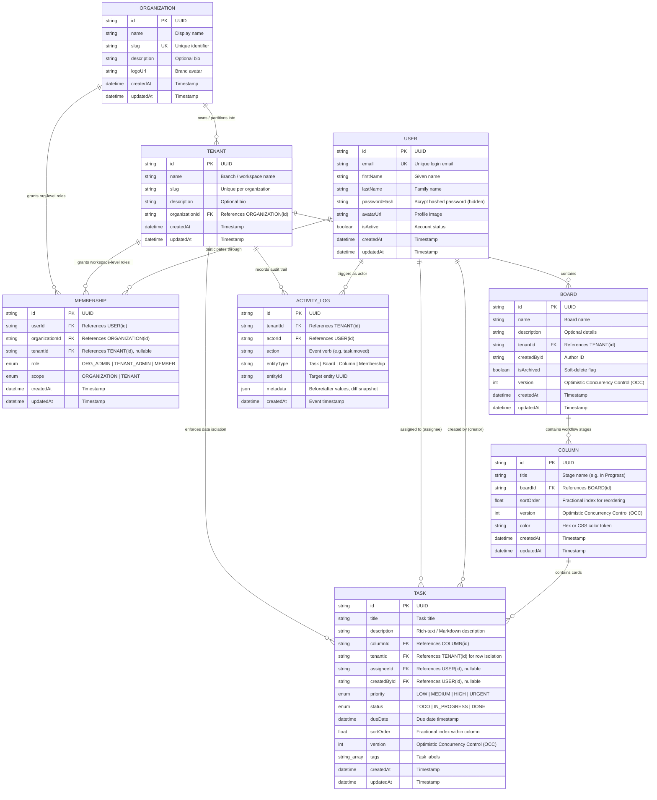

# KanbanFlow — Entity Relationship (ER) Diagram

This document contains the visual database Entity-Relationship (ER) diagram for **KanbanFlow**, a multi-organization, multi-tenant real-time collaborative Kanban board platform built with **PostgreSQL** and **Prisma ORM**.

---

## Visual ER Diagram (Mermaid)

---

## Detailed Model & Relationship Specifications

### 1. `Organization`
- **Purpose**: Top-level SaaS account representing an enterprise or enterprise division.
- **Cardinality**:
  - `Organization` 1 : N `Tenant` (One organization has multiple workspaces/branches).
  - `Organization` 1 : N `Membership` (An organization can have multiple direct member assignments).

### 2. `Tenant`
- **Purpose**: Discrete workspace/branch within an Organization (e.g., "Engineering", "Marketing"). All boards, tasks, and audit logs belong to a Tenant.
- **Constraints**:
  - Composite Unique Index: `@@unique([organizationId, slug])` ensures slug uniqueness within each organization.
- **Cardinality**:
  - `Tenant` N : 1 `Organization` (Cascade delete on organization removal).
  - `Tenant` 1 : N `Board` (A workspace contains many Kanban boards).
  - `Tenant` 1 : N `Task` (Tasks are denormalized with `tenantId` for instant row-level tenant security).
  - `Tenant` 1 : N `ActivityLog` (Workspace audit log stream).

### 3. `User`
- **Purpose**: Global user identity across organizations and workspaces.
- **Security**: `passwordHash` is never included in REST API responses or WebSocket payloads.
- **Cardinality**:
  - `User` 1 : N `Membership` (A user can belong to multiple organizations and workspaces with different roles).
  - `User` 1 : N `Task` (As assignee: `onDelete: SetNull`).
  - `User` 1 : N `Task` (As creator: `onDelete: SetNull`).
  - `User` 1 : N `ActivityLog` (As actor who performed the action).

### 4. `Membership` (Unified RBAC Join Table)
- **Purpose**: Polymorphic role-based access control table that grants permissions at either the Organization level or Workspace (Tenant) level.
- **Scopes & Roles**:
  - `scope = ORGANIZATION`: Grants org-wide access. An `ORG_ADMIN` inherits admin rights to all child tenants automatically.
  - `scope = TENANT`: Grants scoped access strictly within the designated `tenantId`.
  - Roles: `ORG_ADMIN`, `TENANT_ADMIN`, `MEMBER`.
- **Constraints**:
  - Composite Unique Index: `@@unique([userId, organizationId, tenantId])` prevents duplicate memberships.

### 5. `Board`
- **Purpose**: Visual Kanban workflow container.
- **Optimistic Concurrency**: Includes `version: Int @default(0)` incremented on structural changes to detect and prevent collaborative overwrite conflicts.
- **Cardinality**:
  - `Board` N : 1 `Tenant` (Cascade delete).
  - `Board` 1 : N `Column` (Workflow columns).

### 6. `Column`
- **Purpose**: Distinct workflow lane (e.g., "To Do", "In Progress", "In Review", "Done").
- **Ordering**: Uses `sortOrder: Float` allowing fractional updates without modifying siblings.
- **Optimistic Concurrency**: Includes `version: Int @default(0)`.
- **Safe Deletion Policy**: Backend prevents deleting columns that still contain tasks to eliminate accidental data loss.

### 7. `Task`
- **Purpose**: Kanban card containing work item details.
- **Row-Level Multi-Tenancy**: Carries both `columnId` AND `tenantId` to guarantee that queries, moves, updates, and undo/redo operations never cross workspace boundaries.
- **Optimistic Concurrency Control (OCC)**: `version: Int @default(0)`. All move, update, and undo/redo requests verify `incomingVersion === currentVersion`, responding with `409 Conflict` on concurrent mutations.

### 8. `ActivityLog`
- **Purpose**: Immutable append-only audit trail capturing user events within a tenant workspace.
- **Payload**: `metadata: Json?` stores before/after diffs, target column changes, and collaborator details for compliance and live activity stream rendering.
